Compass (block_compass)
=======================

[](https://github.com/uaiblaine/moodle-block_compass/actions/workflows/ci.yml?query=branch%3Amain)
[](https://github.com/uaiblaine/moodle-block_compass/actions/workflows/ci.yml?query=branch%3AMOODLE_502_STABLE)

My courses by relevance, in three tiers, with a calendar strip above them. Built for very
large sites.

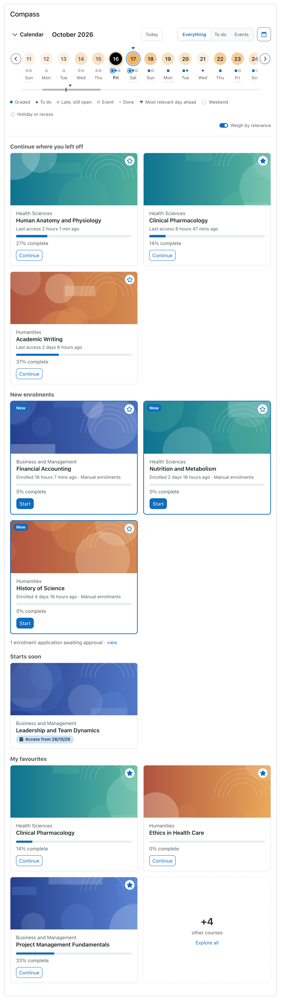

The standard Course overview block sorts courses by time: start and end dates. On sites where
most courses have no end date and no completion rule, that turns into one long "in progress"
list, expensive to build and hard to scan. Compass sorts the same enrolments by **relevance**:
what I was doing, what just arrived, what I marked as mine, and what is due.

- **Calendar strip** (optional). Closed, one line of counts by period; open, a scrolling row of
  days, from ten days ago to the end of next month (it opens on the last five, three on a
  phone), each coloured by what it holds and weighted by relevance. Pointing at a day opens its items with the actions the Timeline block offers.
- **Open for enrolment** (optional, `news_enabled`). A line of its own that tells each user
  which courses they could join start soon, grouped by a reference category (a category of one
  names its course), with a link to each and a × that hides it until the next sign-in. It counts
  only courses that are visible and listed, start inside a band of days around today and offer
  the user a way to enrol now, and never one where the user already holds an enrolment of any
  status or a role.

  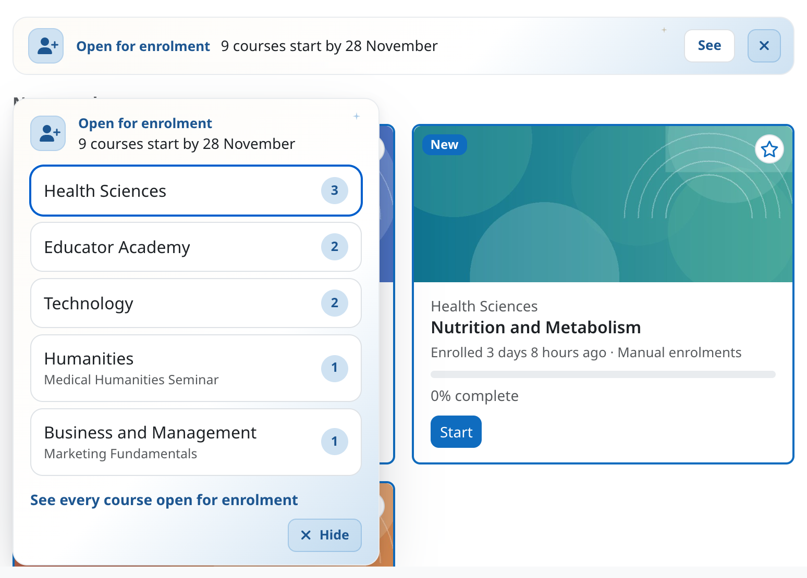
- **Tier 1, attention.** Full cards (image, progress, button) in four strips: *Continue where
  you left off*, *New enrolments*, *Starts soon* and *My favourites*. A strip that overflows
  says so in its heading ("+4 new").
- **Tier 2, frontier.** One ghost card that only counts: "+87 other courses". Counting is
  cheap; rendering is not.
- **Tier 3, exploration.** *All courses*, grouped by category, with a side index and one filter
  line: a scope, a search that suggests as you type, a favourites star, filters, a sort and a
  list or cards view. Rows fetch their progress and image only once they are on screen. Courses
  gone quiet gather in a *Dormant* group, and archived ones in an *Archived* group shared with
  the Course overview block.

Compass owns no database tables: favourites are core's course star, archiving is the Course
overview block's "Removed from view", caches go through MUC and per-user state through user
preferences (see *Data stored*). The server ships a shell and the browser renders it (React); the shell
also draws the first strips' outline from the shape the user's last visit left (`block_compass_tier1`), so
the page does not jump when they load. Every web service has a query budget enforced by an automated test.


The calendar strip
------------------

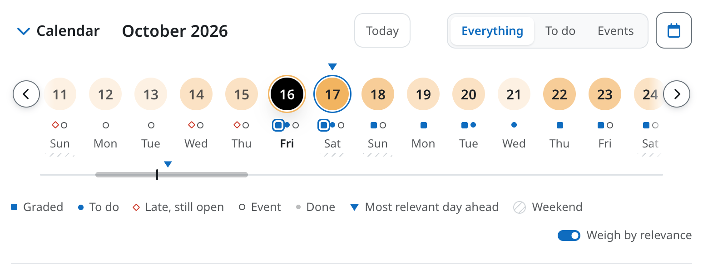

The strip is off by default (`calendar_enabled`). When on, it sits above the first tier on the
Dashboard, on the Compass page, or on both (`calendar_where`), and loads after the first tier so
the cards always paint first.

- **Open or closed.** The strip's heading opens and closes it, and each user's choice is
  remembered; `calendar_start` decides how it first shows to someone who never chose (closed by
  default). Closed, the strip is one line of plain counts by period: *Late, still open*, *Today*,
  *Tomorrow*, *This week* (the five days after tomorrow) and *Later*. A period opens the strip on
  its days, and Today and Tomorrow also open that day's card. A closed strip asks only for these
  counts, never for the whole strip; closing an open strip asks nothing. A count made before the
  strip was opened that day has no *Late* period yet and says so.

  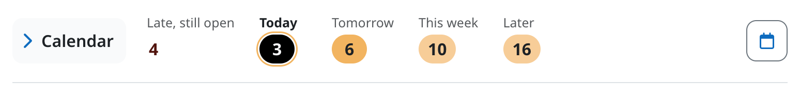
- **Up next.** Under the strip, open or closed, at most two rows show what is still open in the
  next hours: an assignment about to be due, a quiz about to close, an event about to start. Each
  row has its time, a countdown (amber under an hour), *Now* for an event that is on, and the
  action; the ring on *Today* in the strip marks the same moment. It appears only while something
  is inside the horizon (`calendar_soon`) and asks nothing on a calm day. A reader can hide it
  until the urgency rises.

  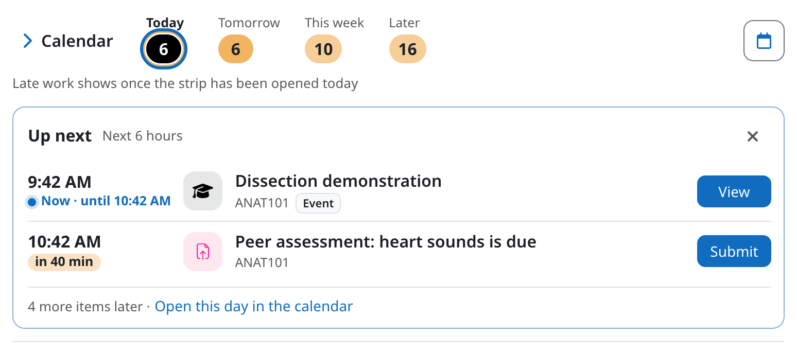
- **Scrolling.** The row holds the whole window and scrolls with a trackpad, touch or the
  keyboard (arrows, Page Up and Down, Home and End), asking the server nothing. It opens with five
  past days before today (three on a narrow block); two arrows over its ends move two weeks at a
  time, *Today* returns, and the month follows the days in view. A map under the row shows the
  whole window, today and the most relevant day ahead: press it to jump, drag it to move. Under
  each day, one mark per kind of item present, at most four, then "+N" more kinds.
- **Relevance.** Graded work, starred courses and work due today or tomorrow weigh more than a
  plain event; work that is late weighs little and closed work is not shown. Each user can
  switch the weighting off and see days by count alone; `calendar_relevance` sets the starting
  value.
- **A day card.** Hovering a day wholly in view, focusing it or clicking it opens a card listing
  the day's items, with the buttons core's Timeline offers, such as "Add submission". A click
  pins the card as a dialog; Escape closes it. On a narrow block it opens as a bottom sheet. Each
  item's button carries a short verb for what core's Timeline would do: Submit, Answer, Attempt,
  Grade, View or Open.

  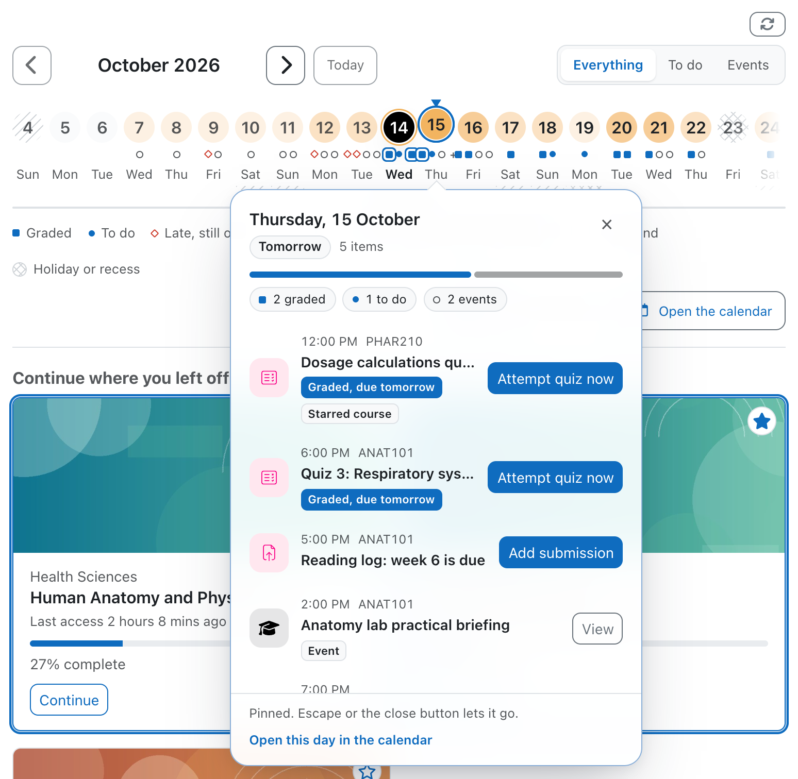

- **Studying and Teaching.** A user who learns in some courses and teaches in others gets a
  switch between the two views; which courses are learning ones follows the site's graded roles
  (`gradebookroles`). The teaching view counts the submissions waiting to be graded, in the same
  group core's grading page shows that teacher first, beside the class's deadlines. An
  *Everything* / *To do* / *Events* filter narrows either view. Both choices are remembered per
  user. Closed, the teaching line counts grading work only with `block_feedback_tracker` (below),
  as a *To grade* cell before the periods; without it, it counts the class's deadlines and
  events, and grading shows once it is open. The switch is two icons (Studying, Teaching) where
  the header is narrow.

  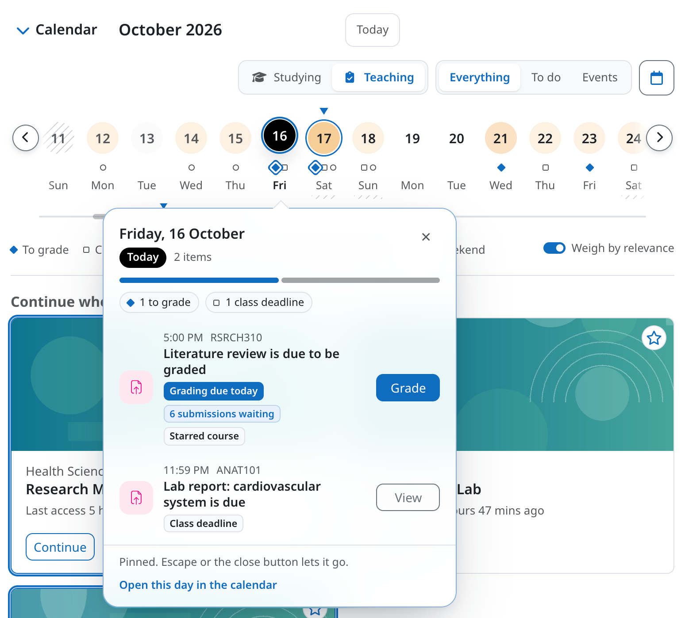

  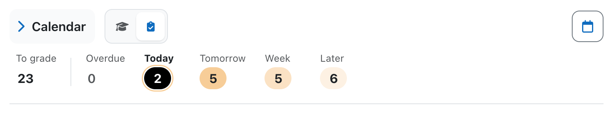

  The picture above is from a site without `block_feedback_tracker`. Where that plugin is
  installed and covers the teacher's courses, the line also carries the *To grade* cell, a divider
  and then the periods; the *To grade* cell and the days off from its calendar are not in any
  picture here.

- **Three styles** (`calendar_style`): dots, a ring per day (fewer days at once), or pulse bars.

  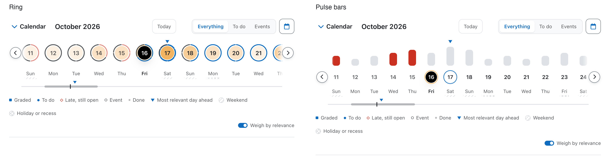

  The pulse style draws each day's load as a bar, red where late work is still open:

  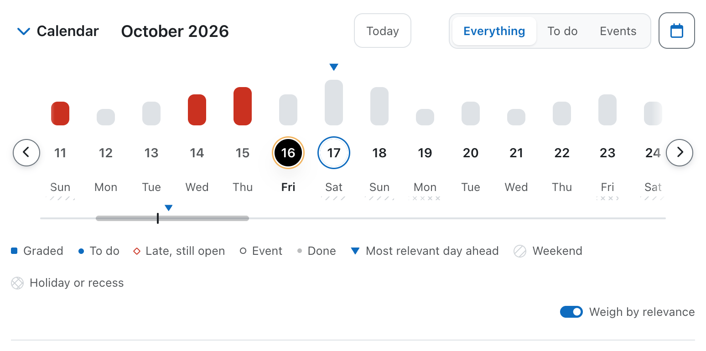

  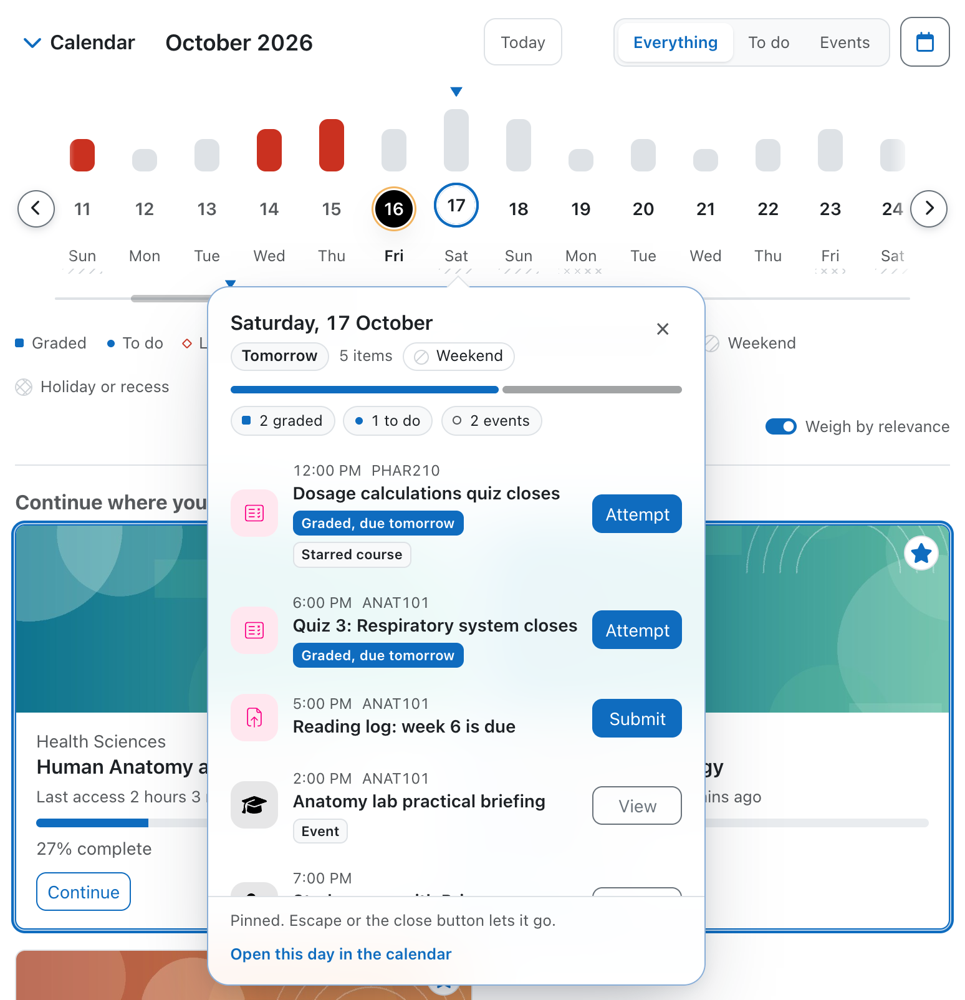

- **Weekends and days off.** Empty weekend days are hatched. With
  [`block_feedback_tracker`](https://github.com/uaiblaine/moodle-block_feedback_tracker)
  installed, its academic calendar decides instead: its weekends, holidays and recesses, each
  named in the day's card.
- **Honest numbers.** A count of future work that may still shrink (an item already submitted,
  an activity that will close) is announced as "up to N" until the day is opened. Only
  activities the user can see are counted, and hidden and completed courses are left out.
- **Linked to the cards.** Pointing at a first-tier card lights the days that hold its course;
  opening a day outlines the cards of its courses. While a card is pointed at, the days that do
  not hold its course dim their fills; their numbers stay legible.

  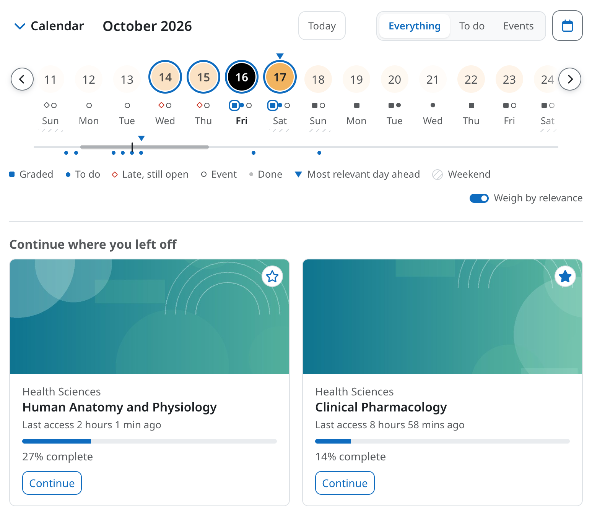
- **Readable everywhere.** Month, weekday and time names come from the language pack, and every
  mark keeps its contrast in dark mode.

  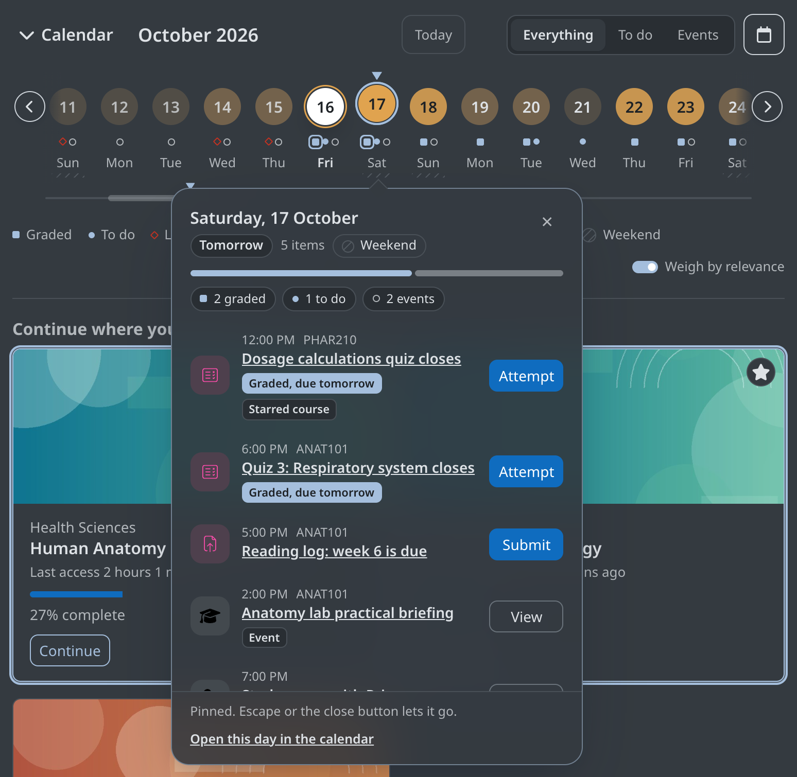


All courses and the Compass page
--------------------------------

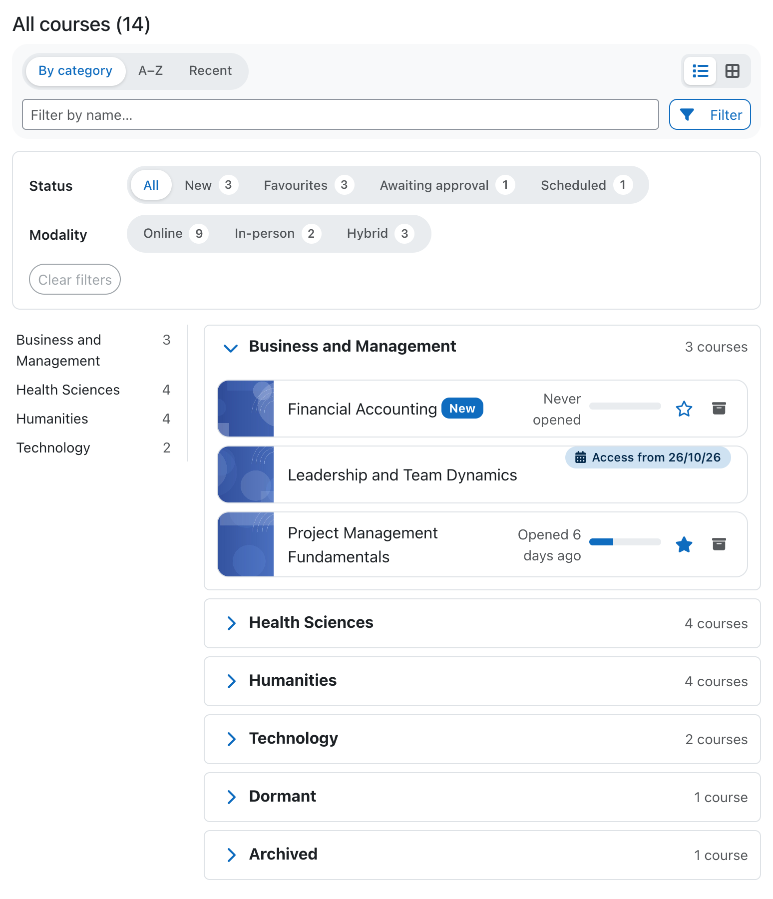

*All courses* opens from the ghost card or from a strip's "+N" link. Above it sits one filter
line, the one the plugin shares with the other Dimensions surfaces, in this order:

- **The scope**: All, New, Awaiting approval (with `enable_pending`) and Scheduled, each with its
  count. One is checked; the arrow keys move between them. A scope that would keep no course is
  left out unless it is the one checked; All always stays.
- **The search**, with an eraser for its text. `/` jumps to it while the line is on screen.
- **The star** (with `enable_favourites`): only the favourites, combined with the scope, so
  New and the star together are the new favourites.
- **Filters** (with `filter_fields`): a panel of the course custom fields the administrator
  chose, at most three, one value per field, the fields combined. Its badge counts the values in
  force; at its foot, *Clear filters* releases everything and *Show N* closes it on the list.
- **Organise**: the sort, *By category*, *A–Z* or *Recent*.
- **The list/cards switch.**

The panel and the menu open as popovers under the line. The values in force show as chips on a
row under the line, each with a cross to remove it, and *Clear all* from two chips up; the scope
and the star stay on the line and need no chip.

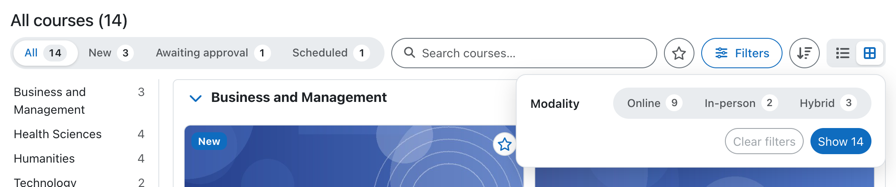

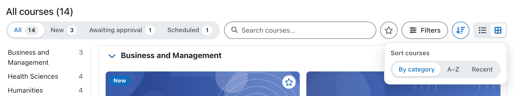

The search suggests as you type, in one list under the line: first the **filters** (a scope,
the star, a field's value) whose name or field matches the text, each with the number of courses
it would leave, then up to five **courses** whose names match, accents and case ignored. Choosing
a filter applies it and empties the field for the next one; choosing a course opens it. With
fewer than two characters typed, the list offers up to five filters, the largest first, under
*Start with a filter*. The arrow keys walk the list, Enter chooses and Escape closes it.

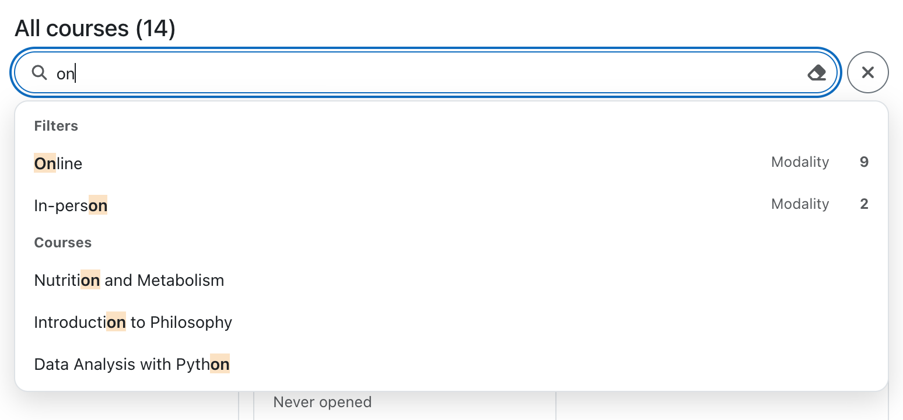

**The line folds to the width of the block, not of the screen**, in four steps measured on the
line itself: everything on one row (the Compass page on a desktop); then Filters keeps its icon
and badge and drops its word; then the search becomes an icon that, when pressed, grows over the
line, slides the other controls aside and offers a close button (the Dashboard's main column);
at the narrowest, two lines: the search, the star, Filters and Organise on the first, the scope on
the second, scrolling sideways, and the list/cards switch moves into Organise (a tablet, a phone,
the block drawer). A search left in force while its field is folded away shows as a chip.

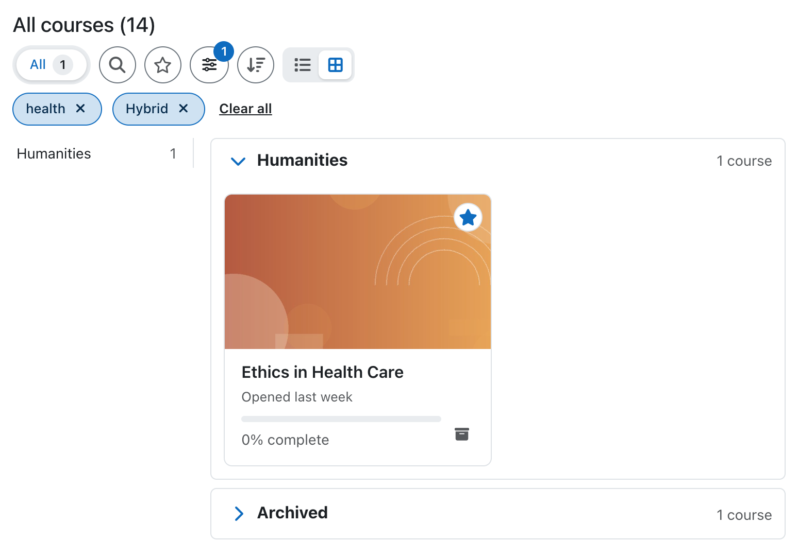

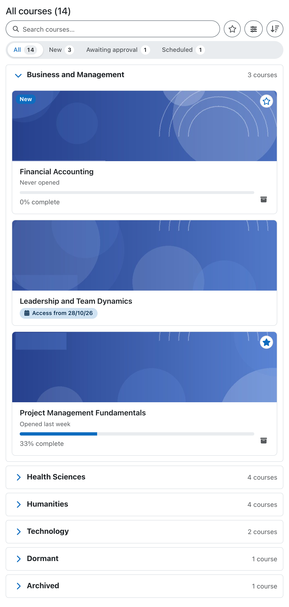

At that last step the Filters panel opens as a bottom sheet:

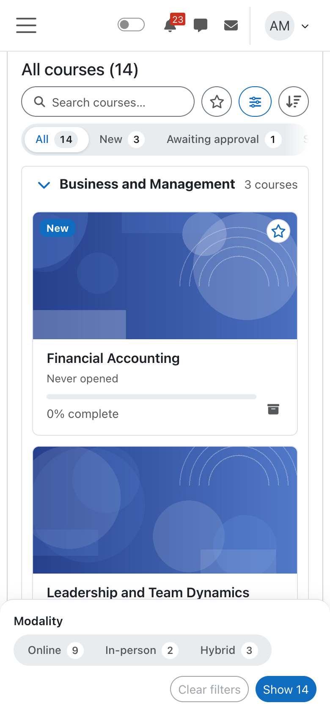

**Pointing at a filter previews it.** A mouse or a pen on a scope, the star, a panel value or a
suggestion, or the keyboard's focus on one, rings the courses on screen that it would keep,
combined with the filters already in force, and dims the others. The dim changes colours, never
transparency, and its text is checked for contrast in light and dark mode. A finger has no hover
and previews nothing, and a control that would only widen the list previews nothing either.

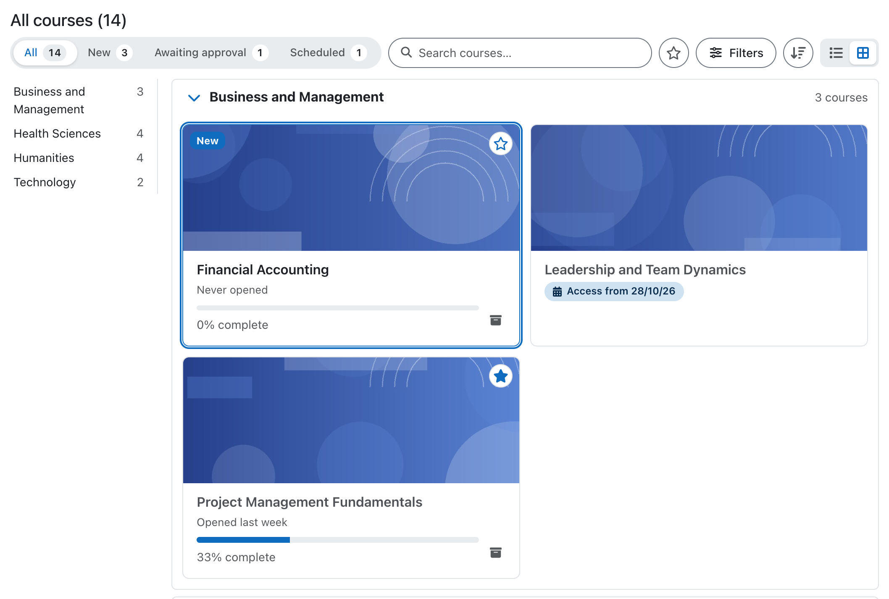

An enrolment that starts later is a row with an *Access from {date}* pill; an application through
*Enrolment on application* (`enrol_apply`) is a row with an *Application under review* or *On the
waiting list* pill. Every row and card carries the star and an archive control; *Dormant* has an
**Archive all** control. The line is remembered per user (scope, star, filters, sort and whether
the panel is open, which starts closed), the search text excepted. In the full list, no filter,
suggestion or preview asks the server anything.

A learner with more courses than `inventory_max` (default 250) gets the same list in **paged
mode**: groups start closed with their counts, open 100 courses at a time, and the search runs
on the server. The scope, the star and the suggestions then carry no counts, since nothing is
counted before a group's rows arrive. The server is asked for one scope at a time (Favourites
while the star is pressed) and the browser narrows the rows it holds by the rest; the course
suggestions are the server's search hits. Nothing is configured per learner.

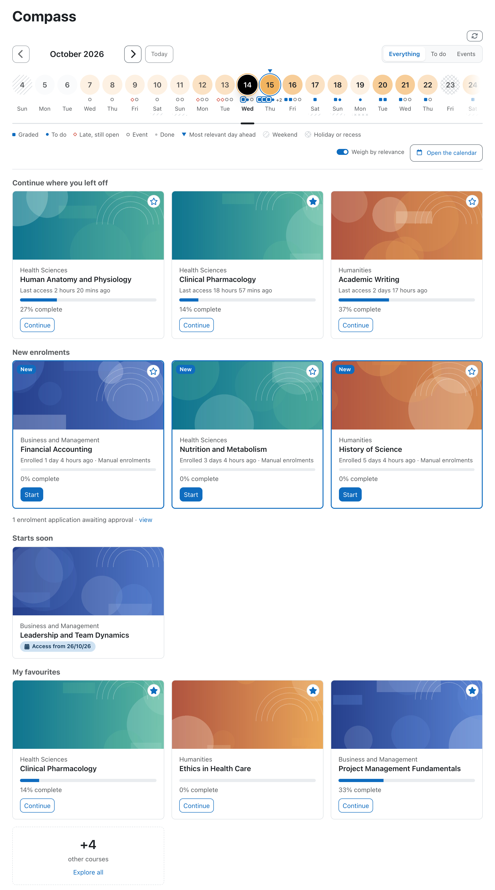

With `enable_page` on, `/blocks/compass/index.php` shows the block's content alone, on the
theme's page without block regions. While it is on, "Compass" is offered under *Site
administration > Appearance > Navigation > Start page for users* and in each user's home page
preference. Off, the page redirects to the Dashboard. Guests are sent to the front page.

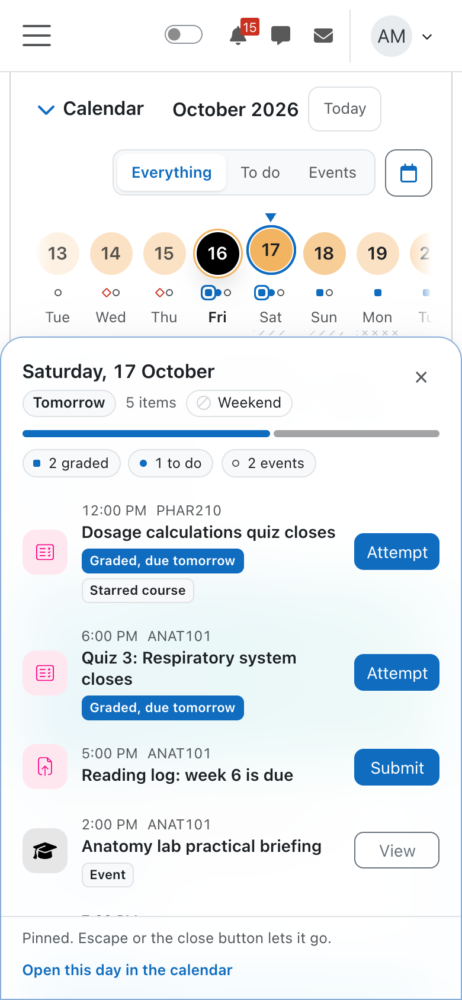

The cards count their columns from the block's own width (three, two or one), so the block works
in the block drawer and on a phone as well as on a wide Dashboard.


Requirements
------------

| Branch | Moodle | PHP | Maturity | Latest release |
|---|---|---|---|---|
| `main` (= `MOODLE_503_STABLE`) | 5.3 | 8.3 or later | Beta | v5.3-r3 |
| `MOODLE_502_STABLE` | 5.2 | 8.3 or later | Beta | v5.2-r3 |

Each branch supports exactly one Moodle version (`$plugin->supported`); its version number is in
`version.php` and each change is listed in `CHANGELOG.md`. Moodle 4.5 and 5.1 are not supported: the
client is React, which core builds and serves from 5.2 on.

- **Required: [`local_unlistedcourses`](https://github.com/uaiblaine/moodle-local_unlistedcourses)**
  from the branch matching your Moodle version (`MOODLE_502_STABLE` for 5.2, version 2026042003
  or later; `MOODLE_503_STABLE`, its `main`, for 5.3, version 2026100505 or later). It decides
  what each enrolment means (enrolled, starting later, awaiting approval, on the waiting list),
  and Compass asks it rather than keeping a rule of its own. Install it first.
- PHP's `intl` extension, which Moodle itself requires.
- Recommended: a shared in-memory cache store, Redis by preference (see *Cache stores*).
- Optional: *Enrolment on application* (`enrol_apply`) for the applications awaiting approval;
  `block_feedback_tracker` for the academic calendar of the strip; a theme or plugin that answers
  the block's `course_badges` hook for the institutional crests on cards (*Course crests*, under
  *Settings*).


Installation
------------

**From a release.** Download the zip attached to the
[GitHub release](https://github.com/uaiblaine/moodle-block_compass/releases) for your Moodle
version (`v5.2-rN` for 5.2, `v5.3-rN` for 5.3) and install it through *Site administration >
Plugins > Install plugins*, or unpack it so that the plugin sits in `blocks/compass` (the zip
holds a `compass/` folder).

**From Git.** Clone the branch for your Moodle version into `blocks/compass` under Moodle's
public directory (`public/` in a 5.2 or 5.3 checkout):

```sh
# Moodle 5.2
git clone -b MOODLE_502_STABLE https://github.com/uaiblaine/moodle-local_unlistedcourses.git public/local/unlistedcourses
git clone -b MOODLE_502_STABLE https://github.com/uaiblaine/moodle-block_compass.git public/blocks/compass

# Moodle 5.3
git clone -b MOODLE_503_STABLE https://github.com/uaiblaine/moodle-local_unlistedcourses.git public/local/unlistedcourses
git clone -b MOODLE_503_STABLE https://github.com/uaiblaine/moodle-block_compass.git public/blocks/compass
```

Then run the upgrade (`php admin/cli/upgrade.php`, or visit *Site administration >
Notifications*). See [Installing plugins](https://docs.moodle.org/en/Installing_plugins).

The block works without configuration. Learners add it through *Edit mode > Add a block* on
their Dashboard, or an administrator adds it to the default Dashboard under *Site
administration > Appearance > Default Dashboard page*.


Settings
--------

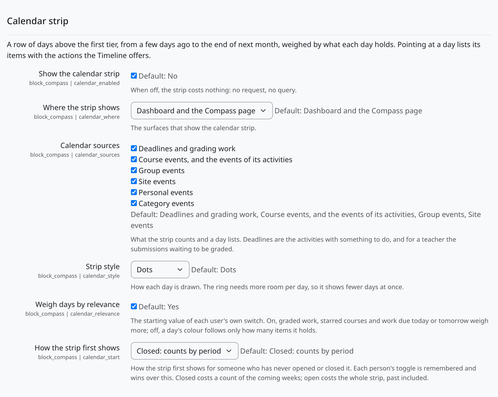

*Site administration > Plugins > Blocks > Compass* (each setting is stored as `block_compass/<name>`):

| Setting | Default | What it does |
|---|---|---|
| `attention_max` | 3 | Cards per strip in the first tier. |
| `new_days` | 30 | Days an unopened enrolment stays *New*. |
| `enable_favourites` | on | The *My favourites* strip and the star. Off hides them; core's favourites are untouched. |
| `group_depth` | 1 | Category depth that forms the groups of *All courses*. |
| `inventory_max` | 250 | Above this many courses, *All courses* switches to paged mode. |
| `enable_search` | on | The search of the filter line in *All courses*, with its suggestions. |
| `show_index` | on | The side index of categories, on wide blocks. |
| `dormant_months` | 12 | Months without a visit before a course moves to *Dormant*. |
| `default_view` | list | The view of *All courses* for a user who never chose (list or cards). |
| `hide_block_title` | off | Render the block without its title; the headings move one level up. |
| `show_category` | on | The category line above the course name on cards. |
| `show_theme_badges` | on | Institutional crests on cards; offered only while a theme or plugin answers the `course_badges` hook. |
| `enable_page` | off | The Compass page and its offer as a start page. |
| `hide_page_title` | off | Hide the Compass page's heading from sight, keeping it for screen readers. |
| `filter_fields` | none | Course custom fields offered in the *Filters* panel of *All courses*: *Dropdown menu* and *Checkbox* fields visible to everyone, at most 3. None, and the line has no Filters. |
| `enable_pending` | off | List the learner's applications through `enrol_apply`. Does nothing without that plugin. |

**Calendar strip**

| Setting | Default | What it does |
|---|---|---|
| `calendar_enabled` | off | Show the strip. Off, it costs no request and no query. |
| `calendar_where` | Dashboard and the Compass page | Where the strip shows: both, the Dashboard only, or the Compass page only. |
| `calendar_sources` | deadlines, course, group and site events | What the strip counts: deadlines and grading work, course events, group events, site events, personal events, category events. |
| `calendar_soon` | 6 hours | The horizon of Up next: off, 3, 6 or 12 hours. Off draws nothing and asks nothing. |
| `calendar_style` | dots | How each day is drawn: dots, ring or pulse bars. |
| `calendar_relevance` | on | The starting value of each user's relevance switch. |
| `calendar_start` | closed | How the strip first shows to someone who never opened or closed it: open (the row of days) or closed (counts by period). |
| `calendar_grading` | Feedback Flow where it tracks the course | Offered only with `block_feedback_tracker`: where the teaching view's count of submissions waiting comes from. |

**Open for enrolment**

| Setting | Default | What it does |
|---|---|---|
| `block_compass/news_enabled` | off | Show the line. Off, it costs no request and no query. |
| `block_compass/news_depth` | 1 | The category level, counted from the top, that courses group under (1 to 4). A course in a shallower category groups under its own. |
| `block_compass/news_past` | 7 days | How many days after its start date a course still counts (none: from today, 7, 14 or 30), in the site timezone. |
| `block_compass/news_ahead` | 30 days | How many days after today a start date still counts (14, 30, 60 or 90), in the site timezone. |

**`block_feedback_tracker` integration.** When that plugin is installed, the strip reads its
academic calendar for weekends, holidays, recesses and school days on a weekend; without it,
weekends are core's *Weekend days* calendar setting. It also counts the submissions waiting to be
graded from the plugin's own ledger, in the courses the plugin tracks (a Feedback Flow block on
the course, a visible course unless its *Process hidden courses* is on), and from Moodle core
elsewhere; `calendar_grading` can keep Moodle core for every course. The two definitions of
waiting differ: the ledger counts a submission answered in the gradebook as answered, a team
submission once per member, files a student in several groups under the group joined most
recently, and leaves out a suspended enrolment only at its next sweep. Its README lists every
difference under *What counts as pending*. Only with the ledger does the closed strip show
grading work, led by the number of submissions waiting.

**Pre-warming (optional)**

| Setting | Default | What it does |
|---|---|---|
| `enable_prewarm` | off | Run the nightly task *Pre-warm the course inventory of recently active users* (04:00 site time, at a random minute). |
| `prewarm_days` | 7 | Warm only users active within this many days. |
| `prewarm_budget_seconds` | 10 minutes (minimum 1 minute) | Time budget per run; an unfinished sweep resumes the next night. |

Pre-warming moves the cost of building a learner's course list from their first visit of the
day into the night. It helps only very large sites, and only with a shared cache store: on a
multi-node site without one, the cron node warms a file cache no web node reads.

### Cache stores

Compass keeps nine MUC application caches (`coursemeta`, `categorymeta`, `coursefields`,
`filterfields`, `inventory`, `details`, `calendarstrip`, `catalogue`, `news`). Map all nine to a **shared in-memory
store, Redis by preference**, under *Site administration > Plugins > Caching > Configuration*:
add a Redis store instance, then use *Edit mappings* on each Compass definition, or set the
store as the default application store. The block works without it, but every web node then
rebuilds each user's caches in its own file store, and performance on a large site degrades
severely. The settings page repeats this notice.

**Course crests**

Compass names no theme. To draw a course's institutional crests it dispatches its own hook,
`\block_compass\hook\course_badges`, once per response with the ids of the courses it is
about to draw, and any theme or plugin answers from its `db/hooks.php`:

```php
// db/hooks.php of the answering component.
$callbacks = [
    [
        'hook' => \block_compass\hook\course_badges::class,
        'callback' => \theme_example\hook_callbacks::class . '::course_badges',
    ],
];

// classes/hook_callbacks.php: answer only for courses the current user may see.
public static function course_badges(\block_compass\hook\course_badges $hook): void {
    foreach (my_crests_for_the_viewer($hook->get_courseids()) as $courseid => $crests) {
        $hook->add_badges($courseid, $crests); // A list of ['url' => string, 'alt' => string].
    }
}
```

The answering component decides which courses the current user may see a crest for; Compass
keeps at most three a course and ignores an answer for a course it did not ask about. The
contract is the hook class's docblock and ADR-013 decision 9, amended 2026-10-14.


Capabilities
------------

- `block/compass:myaddinstance`: add the block to one's own Dashboard (and, for administrators,
  to the default Dashboard). Default: authenticated user. The block lives on the Dashboard only,
  so there is no `addinstance` capability.


Web services
------------

Ten read-only functions, callable over AJAX after login, never by the guest account. Each
answers for the current user (none accepts a user id) and runs without the session lock on a
site that enables read-only sessions:

| Function | Purpose |
|---|---|
| `block_compass_get_attention` | The first tier: strips, ghost counts and notices. |
| `block_compass_get_inventory` | *All courses*: every course grouped by category, or the group headers in paged mode. |
| `block_compass_get_inventory_rows` | Paged mode: one page of up to 100 courses of one group. |
| `block_compass_search_inventory` | Paged mode: up to 50 courses matching a search. |
| `block_compass_get_card_details` | Progress and image for up to 24 courses on screen. |
| `block_compass_get_strip` | The calendar strip: per-day counts for the window. |
| `block_compass_get_strip_counts` | The calendar strip closed: plain counts by period. |
| `block_compass_get_day` | One day of the strip: its items with core's actions. |
| `block_compass_get_soon` | Up next: the items still open from now to the horizon (`calendar_soon`). |
| `block_compass_get_news` | Open for enrolment: the groups of courses the user could still join, starting inside the band (`news_enabled`). |

Writes go to core's own services: the star through `core_course_set_favourite_courses`, the
view, the filter line, the strip's choices, the first strips' shape and archiving through core's
user preferences.

**Hooks.** Compass listens to three of core's hooks (`db/hooks.php`): the top of the body, where it
adds preload hints for its modules on the pages that show it; the default home page, where it offers
its own page; and a course about to be deleted, where it drops that course from its shared cache. It
also dispatches two hooks of its own for other plugins and themes to answer:
`\block_compass\hook\course_badges` (crests on cards, see *Course crests*) and
`\block_compass\hook\category_link` (where a category in the open-for-enrolment line leads). Neither
sends personal data: they receive course or category ids and return crests (an image address and
its alternative text) or URLs, and a listener answers only for courses the current user may see.


Data stored
-----------

**Database tables: none.** The plugin has no `db/install.xml`. What it keeps is:

| What | Where | What it holds | How long | What removes it |
|---|---|---|---|---|
| `block_compass_view` | User preference | The view of *All courses* the user chose: list or cards. | Until changed | Uninstalling the plugin; deleting the account |
| `block_compass_explore` | User preference | The filter line of *All courses* as the user left it: scope, star, filters, sort and whether the panel is open (never the search text). | Until changed | Uninstalling the plugin; deleting the account |
| `block_compass_calendar` | User preference | The strip as the user left it: studying or teaching view, filter, relevance switch, open or closed, the level at which the user hid Up next and whether the user hid the open-for-enrolment line, each for that sign-in: the hidden states keep the session's login time (`$USER->currentlogin`) and lapse at the next sign-in. | Until changed | Uninstalling the plugin; deleting the account |
| `block_compass_tier1` | User preference | The shape the first strips last settled to on the Dashboard and on the block's own page, so the next page holds their place before they load: which strips showed, how many cards each (at most 24) and whether any showed progress, whether the more-courses card and the applications notice showed. No course, name or date. Written by the browser only when the shape changes. | Until changed | Uninstalling the plugin; deleting the account |
| `inventory` | MUC cache, per user | The user's enrolment rows as integers (course, dates, status, last access, star and, for an application awaiting approval, its enrolment method's id) and the stamp that tells whether they are still current; no course data. | 24 hours | Its TTL; deleting the account; purging caches |
| `details` | MUC cache, per user and course | The user's progress percentage in a course, or that completion is not tracked for them. | 1 hour | Its TTL; deleting the account; purging caches |
| `calendarstrip` | MUC cache, per user | The strip's counts per day of the user's calendar events, completion and grading work, the course ids behind each day, the sets of courses and groups a day reuses, the days opened, the first day, the timezone and the sign-in it was built for. | 30 minutes | Its TTL; deleting the account; purging caches |
| `news` | MUC cache, per user | The open-for-enrolment line's answer for the user: up to 20 groups (category, count, link, with the category and course names already formatted in the user's language) and the sign-in, language and catalogue digest it was built from. | 30 minutes | Its TTL; deleting the account; purging caches |
| `catalogue` | MUC cache, shared | The courses that are visible and listed, start inside the band and offer an enrolment route open now: course, category and start date, up to 500. No personal data. | Rebuilt after a course, enrolment method or discoverability change, and at most every 10 minutes | Core's events; purging caches |
| `coursemeta`, `categorymeta`, `coursefields`, `filterfields` | MUC caches, shared | Course and category names, dates and custom field values: no personal data. | Until the course, category or field changes | Core's events; purging caches |
| `prewarm_cursor`, `prewarm_since`, `prewarm_lastsweep` | Plugin configuration | Where the pre-warming task stopped (a user id), the activity window it walks and when it last finished a sweep. Site state. | Until the next run | Uninstalling the plugin |

Two kinds of row the block writes belong to core and stay core's: the favourite star is
`core_favourites` (component `core_course`), written through `core_course_set_favourite_courses`,
and archiving writes the Course overview block's `block_myoverview_hidden_course_<id>`
preferences. Compass never stamps a core row with its own component. Courses, enrolments,
progress and calendar events are read, never copied, except into the caches above.

Compass sends nothing to any external service, sets no cookie, uses neither `localStorage`,
`sessionStorage` nor IndexedDB, and ships no tracking or analytics code: everything it keeps is in the
places listed above.

**A data export** (*Site administration > Users > Privacy and policies*) carries the four
preferences: the view as its label, the filter line, the strip and the first strips' shape as the
JSON the user's browser wrote. The caches are not exported: they hold copies of core data that core's own export
carries. The star and the archive are exported by `core_course` and `block_myoverview`.

**A data deletion** of the user's own context removes every preference of the user through
core's user provider (`core_user\privacy\provider` deletes all of the user's `user_preferences`
rows), the four of Compass among them. Deleting the account removes them as well, and Compass drops
that user's `inventory`, `details`, `calendarstrip` and `news` entries at once;
whatever the account deletion cannot reach expires with the TTLs above. **Uninstalling** the
plugin removes its configuration, its task, its caches and the four preferences of every user;
the archive rows stay, since they are the Course overview block's.


Accessibility
-------------

The bar is WCAG 2.2 AA. Core's axe check runs inside every Behat scenario, scoped to the block,
and a static test reads what axe cannot (headings, names of icon-only controls, focus, target
sizes, contrast tokens for dark mode). A real screen reader and Windows forced-colours mode have
not been tested. Details: [ADR-008](docs/adr/008-accessibility-docs-and-release.md).


Performance
-----------

Every web service has a database-read budget asserted by a PHPUnit test: the first tier costs at
most 7 reads with the shared caches warm and a page of *All courses* or a search at most 3, each
plus one read of the web-service layer, and a calendar strip already cached costs 2. On
PostgreSQL with over a million enrolments, an ordinary user's first paint took under 6 ms of
database time. One cached course list of 2 000 enrolments occupies about 272 KB in a default
Redis store (122 KB with igbinary). Methods, numbers and their dates are in
[`docs/perf/`](docs/perf/); the reasoning in [`docs/adr/`](docs/adr/README.md).

### Sizing

A Dashboard load makes these requests of the block's own: `get_attention`; `get_card_details`, only
when a card's progress is still pending; one request carrying both `get_strip_counts` (or `get_strip`
when the calendar strip is open) and `get_news`, through core's batched AJAX (`get_news` goes alone
when the calendar is off, and `get_strip_counts` alone while the open-for-enrolment line is hidden; a
read the batch did not answer is asked again on its own); and `get_soon`, only when its gate opens.
Each request pays Moodle's per-request bootstrap. One write is rare: core's preference route saves `block_compass_tier1` only when the first
strips settled to a shape other than the one stored (a strip gaining or losing cards), never per load. On the development stack the cheapest web service (`core_session_time_remaining`) took
24.5 ms, and the block's reads 26 to 65 ms warm; that is a development-stack number, so measure on
your own hardware. The cache stores that keep the reads cheap are under *Cache stores* above.

The block's web services declare `readonlysession`, which core honours only when config.php sets
`$CFG->enable_read_only_sessions = true;`. It is not an admin setting. Without it, one viewer's
requests wait for each other on the session lock, and on a Dashboard the block's reads also wait
for core's own. Measured with four concurrent `get_attention` calls: sharing one session, 19
requests a second and a 95th percentile of 989 ms (1,467 ms at eight calls); on separate sessions,
59 to 69 requests a second and 75 to 192 ms. Before enabling it, map every cache definition in
session mode to a store other than the session store: core refuses to start a session otherwise.
*Site administration > Reports > Performance overview* shows a check that says whether the flag is set.


Troubleshooting
---------------

- **The block is not shown.** It renders only for logged-in, non-guest users.
- **"JavaScript is required".** The browser renders the block; JavaScript is not optional.
- **Slow Dashboard on a large site.** Check that the nine cache definitions are mapped to a
  shared in-memory store, not the default file store.
- **All courses opens with every group closed.** The learner has more than `inventory_max`
  courses: that is paged mode.
- **A course vanished from All courses.** Look in the *Dormant* and *Archived* groups at the
  end of the list; a course removed from view in the Course overview block is under *Archived*.
- **No calendar strip.** Check `calendar_enabled` and `calendar_where`; the strip shows only
  where it is configured, and only after the first tier has loaded.


Development
-----------

- Development happens on `main` (Moodle 5.3, identical to `MOODLE_503_STABLE`); fixes are
  carried to `MOODLE_502_STABLE`, whose `version.php` and CI workflow differ on purpose.
- Tests: PHPUnit (a behaviour test and a budget test beside every web service), Behat smoke
  scenarios with core's axe step, and mutation gates (`mutations/gates.conf`, one guard per
  line with the test that must fail when the guard is removed).
- CI runs [moodle-plugin-ci](https://github.com/moodle-an-hochschulen/moodle-workflows) for each
  branch's Moodle version, on PHP 8.3 and 8.4 against PostgreSQL and MariaDB, with the static
  gates at zero warnings.
- The client is TypeScript and React under `js/esm/src`, built into `js/esm/build` (tracked,
  including the bundle and its manifest). On Moodle 5.3 the build also writes a `.dev.js` twin
  of each module and `js/esm/src/swizzle.json`, which declares every component closed to theme
  overrides: the page loads the bundle, so an override of a single module would never apply.
- Design decisions: [`docs/adr/`](docs/adr/README.md). Measurements: [`docs/perf/`](docs/perf/).
  Changes: [`CHANGELOG.md`](CHANGELOG.md).


Credits
-------

The shape of a shell block rendered in the browser follows the sibling plugin
`block_dimensions`.


Translations
------------

The English strings ship in the package. The Brazilian Portuguese translation is maintained in
this repository (`lang/pt_br`) and reaches sites through [AMOS](https://lang.moodle.org/), as the
plugins directory requires; it is left out of the release package.


License
-------

This plugin is licensed under the [GNU GPL v3 or later](http://www.gnu.org/copyleft/gpl.html).

Copyright: 2026 Anderson Blaine
